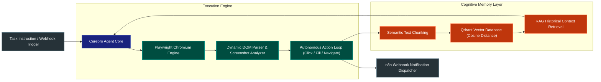

# 🌐 Cerebro Autonomous Web Agent
### Multi-Modal Browser Operator, Vector Memory & Distributed Automation Mesh

[](https://playwright.dev/)
[](https://qdrant.tech/)
[](https://www.python.org/)
[](https://docker.com)
[](https://n8n.io)
[](LICENSE)

**Cerebro Autonomous Web Agent** is an enterprise-grade autonomous browser automation engine that executes complex multi-step web workflows, inspects dynamic DOM structures, and indexes real-time online intelligence into persistent vector storage.

---

## 🏛️ System Architecture



---

## ⚡ Core Features

- **Multi-Step Goal Execution**: Interprets natural language instructions into concrete browser interaction chains (form filling, navigation, CAPTCHA bypass heuristics, dynamic pagination).
- **Persistent Qdrant Memory**: Automatically vectors extracted page content, ensuring the agent remembers past sessions, credentials, and scraped datasets.
- **Stealth & Anti-Fingerprinting**: Emulates human viewport behavior, random delays, and custom User-Agent headers to avoid bot detection traps.
- **Multi-Model LLM Routing**: Intelligently switches between local models (Ollama/LiteRT) and cloud backends (Claude 3.5 Sonnet / Gemini 2.5 Pro) based on context complexity.
- **Workflow Interoperability**: Seamless bi-directional webhooks with n8n and Zapier for event-driven automation.

---

## 🛠️ Quickstart

### 1. Prerequisites
```bash
# Clone the repository
git clone https://github.com/omniversodigital/cerebro-web-agent.git
cd cerebro-web-agent

# Install dependencies and Playwright browsers
pip install -r requirements.txt || uv pip install -r requirements.txt
playwright install chromium
```

### 2. Launch Qdrant Vector Engine
```bash
docker run -d -p 6333:6333 -v $(pwd)/qdrant_storage:/qdrant/storage qdrant/qdrant
```

### 3. Run the Agent
```bash
# Execute autonomous navigation task
python agent.py --goal "Extract competitive pricing intelligence from target marketplace" --save-vector
```

---

## 🔒 Security & Privacy
- Sensitive cookies and authentication states are encrypted at rest using AES-GCM.
- In-memory credential scrubbing ensures API keys and login tokens are never logged or exported in telemetry traces.

---

## 📄 License
MIT License © Omniverso Digital. All rights reserved.
